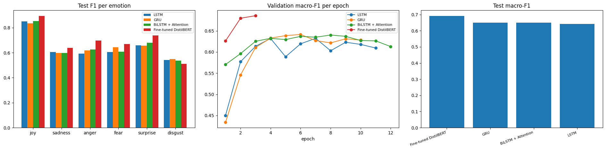
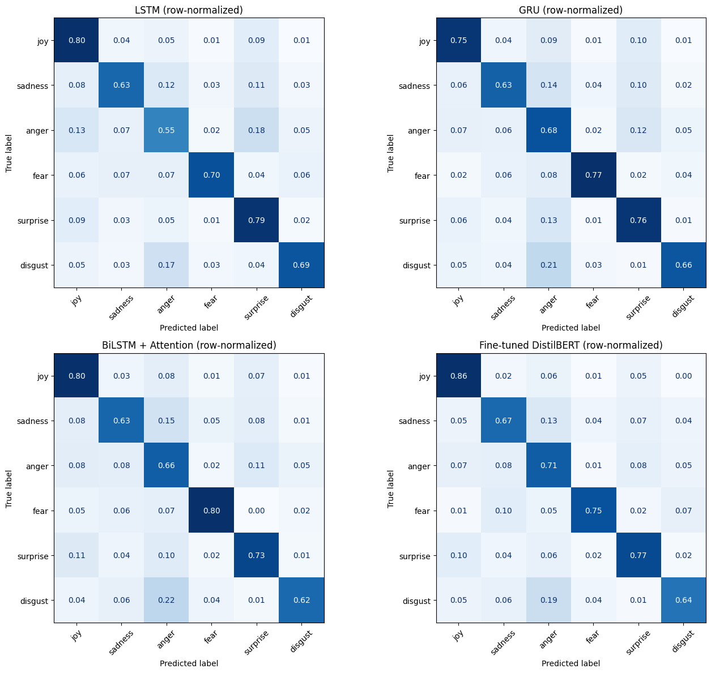
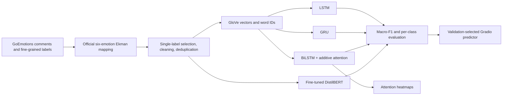
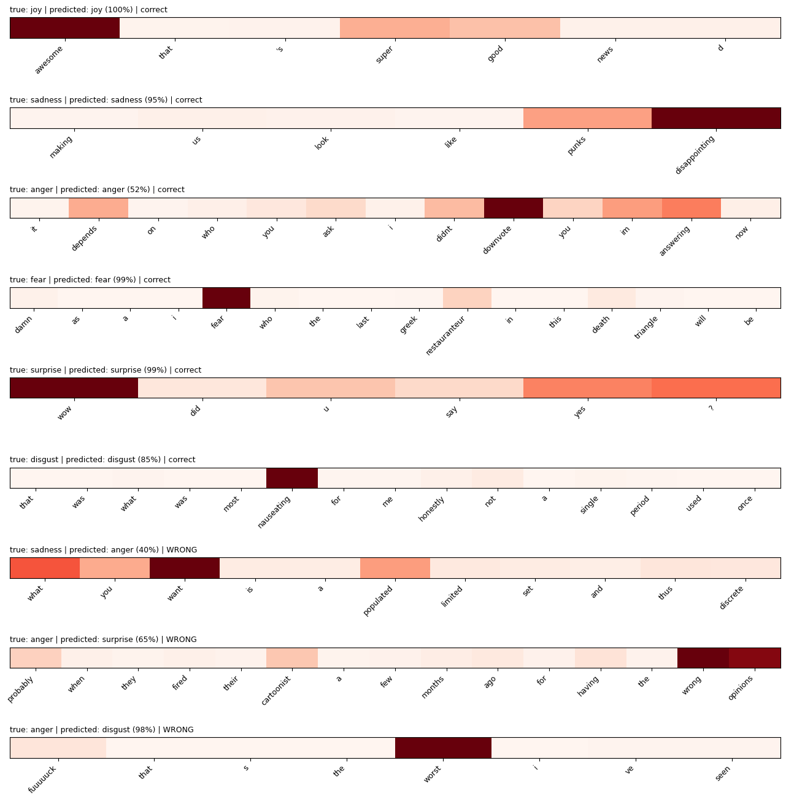

<div align="center">

# Emotion Classification with Attention
### GoEmotions · LSTM · GRU · BiLSTM + Attention · DistilBERT

[](https://www.python.org/)
[](https://pytorch.org/)
[](https://huggingface.co/)
[](https://www.gradio.app/)

**Best recorded test macro-F1: 0.6916 · Fine-tuned DistilBERT**

A complete NLP workflow for six-class emotion classification—from GoEmotions label mapping and text preparation to model benchmarking, attention visualization, and an interactive Gradio app.

</div>

---

## Project overview

This project maps the fine-grained GoEmotions annotations to six broad emotion categories and compares recurrent neural networks with a fine-tuned transformer. The selected model predicts a dominant emotion and confidence scores; a separate BiLSTM + Attention model provides a word-level attention view.

| At a glance | Details |
|---|---|
| **Task** | Single-label emotion classification |
| **Dataset** | GoEmotions simplified configuration |
| **Target classes** | Joy · Sadness · Anger · Fear · Surprise · Disgust |
| **Models** | LSTM · GRU · BiLSTM + Attention · Fine-tuned DistilBERT |
| **Selection metric** | Validation macro-F1 |
| **Best recorded model** | Fine-tuned DistilBERT |
| **Best test macro-F1** | **0.6916** |
| **Demo** | Gradio emotion and attention explorer |

## Results

The table reports the saved experiment run. Macro precision, recall, and F1 weight each of the six emotions equally. The best checkpoint is selected using validation macro-F1; the test split is used for final reporting.

| Model | Test accuracy | Test macro precision | Test macro recall | Test macro-F1 | Validation macro-F1 | Parameters (M) | Train time (min) |
|---|---:|---:|---:|---:|---:|---:|---:|
| **Fine-tuned DistilBERT** | **0.7950** | **0.6618** | **0.7325** | **0.6916** | **0.6858** | 66.9581 | 3.58 |
| GRU | 0.7280 | 0.6126 | 0.7080 | 0.6499 | 0.6414 | **2.2458** | **0.45** |
| BiLSTM + Attention | 0.7435 | 0.6130 | 0.7060 | 0.6499 | 0.6401 | 2.4103 | 0.96 |
| LSTM | 0.7363 | 0.6121 | 0.6939 | 0.6422 | 0.6323 | 2.2752 | 0.56 |

### Test F1 by emotion

| Emotion | LSTM | GRU | BiLSTM + Attention | **DistilBERT** |
|---|---:|---:|---:|---:|
| Joy | 0.850 | 0.835 | 0.852 | **0.894** |
| Sadness | 0.605 | 0.597 | 0.597 | **0.640** |
| Anger | 0.593 | 0.619 | 0.626 | **0.696** |
| Fear | 0.605 | 0.644 | 0.609 | **0.670** |
| Surprise | 0.659 | 0.656 | 0.679 | **0.739** |
| Disgust | 0.541 | **0.548** | 0.536 | 0.510 |

DistilBERT leads on overall macro-F1 and five of the six emotion categories. GRU and BiLSTM + Attention tie on test macro-F1 among the recurrent models, while GRU uses the fewest parameters and has the shortest training time in this run.

### Model comparison



### Confusion matrices

The row-normalized matrices show how each model distributes predictions for each true emotion.



## Dataset and label mapping

The notebook loads the `simplified` configuration of `google-research-datasets/go_emotions`. The raw splits contain 27 emotion labels plus `neutral`; the project groups the emotion labels with the official GoEmotions Ekman mapping.

| Target emotion | GoEmotions labels grouped into it |
|---|---|
| **Joy** | joy, amusement, approval, excitement, gratitude, love, optimism, relief, pride, admiration, desire, caring |
| **Sadness** | sadness, disappointment, embarrassment, grief, remorse |
| **Anger** | anger, annoyance, disapproval |
| **Fear** | fear, nervousness |
| **Surprise** | surprise, realization, confusion, curiosity |
| **Disgust** | disgust |

Each retained comment has one target class: comments are kept when all of their emotion labels map to the same target emotion. Neutral-only comments and comments mapping to multiple target emotions are excluded from this single-label experiment.

| Split | Raw comments | Neutral-only removed | Mixed emotions removed | Kept after mapping | Final after cleaning and overlap removal |
|---|---:|---:|---:|---:|---:|
| Train | 43,410 | 12,823 | 2,483 | 28,104 | 27,780 |
| Validation | 5,426 | 1,592 | 307 | 3,527 | 3,459 |
| Test | 5,427 | 1,606 | 282 | 3,539 | 3,474 |

### Final training distribution and class weights

| Emotion | Training comments | Class weight |
|---|---:|---:|
| Joy | 15,545 | 0.30 |
| Sadness | 2,439 | 1.90 |
| Anger | 4,568 | 1.01 |
| Fear | 565 | 8.19 |
| Surprise | 4,141 | 1.12 |
| Disgust | 522 | 8.87 |

Class-weighted cross-entropy is used for all four models, including the custom Hugging Face `Trainer` loss. Macro-F1 is the primary comparison metric so each target emotion contributes equally to the headline score.

## Modeling workflow



### Text and embedding preparation

- Lowercase text, remove URLs and selected placeholders, normalize contractions, and preserve `!` and `?` as tokens.
- Remove duplicate normalized comments and remove validation/test comments that overlap with earlier splits.
- Initialize a 100-dimensional vocabulary from GloVe 6B (`glove-wiki-gigaword-100`). The saved run covers **99.1% of token occurrences** in each split.
- Pad recurrent inputs to 40 tokens. In the saved training set, no comment exceeds this length.

### Recurrent models

The LSTM and GRU classify from their final hidden state. The BiLSTM + Attention model reads each comment in both directions and uses additive attention over the valid token states. The three recurrent architectures use the same GloVe initialization, 128-unit hidden size, 0.4 dropout, class weights, and recurrent training recipe.

### Transformer model

`distilbert-base-uncased` is fine-tuned for six-way sequence classification using the original comment text and a class-weighted loss. The best validation macro-F1 checkpoint is retained.

## Attention visualization

Attention weights from the BiLSTM + Attention model are visualized for correctly and incorrectly classified test comments. The notebook also summarizes high-attention words by predicted emotion.



In the Gradio app, the dominant emotion and confidence chart come from the validation-selected model (DistilBERT in the saved run). The highlighted words are produced by the BiLSTM + Attention model, so the prediction and attention view can come from different architectures.

## Interactive Gradio app

The app accepts a short comment and returns:

1. The dominant emotion and its confidence.
2. A bar chart with confidence scores for all six emotions.
3. A word-level attention highlight from BiLSTM + Attention.

The packaged notebook launches Gradio locally by default. A public temporary link can be enabled explicitly when you intend to share the demo.

## Run the notebook

### Recommended environment

- Kaggle Notebook or Jupyter
- Python 3.10 or newer
- Internet access for GoEmotions, GloVe, and DistilBERT downloads
- CUDA-enabled GPU recommended; the recorded run used a **Tesla T4**

### Run

```bash
pip install -r requirements.txt
jupyter lab emotion-classification-with-attention.ipynb
```

Run all cells from top to bottom. In Kaggle, enable Internet and select a GPU accelerator first. Dataset and pretrained weights are downloaded at runtime and are not bundled with this repository.

### Generated artifacts

The notebook writes its files to `/kaggle/working` in Kaggle or `./working` elsewhere:

- `model_comparison.csv`
- `per_class_<model>.csv`
- `emotions.json`
- The selected model checkpoint and tokenizer (for DistilBERT)
- `bilstm_attention_for_explanations.pt`

## Repository structure

```text
.
├── emotion-classification-with-attention.ipynb
├── README.md
├── requirements.txt
├── .gitignore
└── assets/
    ├── model-comparison.png
    ├── confusion-matrices.png
    └── attention-heatmaps.png
```

## Future enhancements

- Add multi-seed evaluation and confidence intervals.
- Compare soft-label training based on annotator vote distributions.
- Add confidence calibration and threshold analysis.
- Publish a hosted Gradio demo with an inference latency report.

## References

- [GoEmotions: A Dataset of Fine-Grained Emotions](https://research.google/pubs/goemotions-a-dataset-of-fine-grained-emotions/)
- [Official GoEmotions Ekman mapping](https://raw.githubusercontent.com/google-research/google-research/master/goemotions/data/ekman_mapping.json)
- [DistilBERT base uncased](https://huggingface.co/distilbert/distilbert-base-uncased)
- [GloVe: Global Vectors for Word Representation](https://nlp.stanford.edu/projects/glove/)
